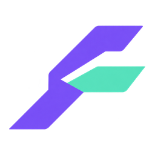

  

<h1 align="center">Chronos</h1>

  <b>Desktop app for AI coding agents: Claude Code, Codex, OpenRouter and more, with a full Russian UI.</b> 
  <b>Десктоп-приложение для ИИ-агентов программирования на русском языке.</b>

  
  
  
  
  

  <a href="https://github.com/Zulut30/Chronos/releases/latest"><b>Download</b></a> ·
  <a href="#features">Features</a> ·
  <a href="#русский">На русском</a> ·
  <a href="#faq">FAQ</a>

---

**Chronos** is a fork of [T3 Code](https://github.com/pingdotgg/t3code), the open-source control plane for coding agents. It keeps everything T3 Code does:
- runs Claude Code, Codex, Cursor, OpenCode and other agents with your own subscriptions;
- uses git worktrees, diffs and pull requests;
- has remote access through **T3 Connect** and the T3 Code mobile app.

On top of that, Chronos adds:
- a polished **Olympus** theme;
- a complete **Russian localization**;
- extra tools for agent-driven development.

> Chronos is a community project. It is **not affiliated with T3 Tools / Ping Labs**. T3 Code is MIT-licensed; Chronos is too.

## Features

| | |
|---|---|
| ⚡ **Everything from T3 Code** | One fast interface for Claude Code, Codex, Cursor, OpenCode, Grok, Kiro and any ACP agent. Threads, worktrees, diff review, PRs, terminal. |
| 📱 **T3 Connect and mobile** | Same relay and sign-in as official builds. Pair the T3 Code iOS/Android app and approve agent steps from your phone. |
| 🏛 **Olympus theme** | Built in and selected by default: day (cream + royal blue) and night (navy + gold), following your system appearance. |
| 🇷🇺 **Russian UI** *(next release)* | A full, separate Russian language. English stays available in Settings. |
| 🔄 **Updates from GitHub Releases** | The app checks this repo for new versions. Upstream T3 Code changes are reviewed and merged manually, so nothing breaks unexpectedly. |

**Coming next** (already running in the author's setup, being ported into the fork):
- [ ] Excalidraw boards in the side panel: send a board to the chat as an image + file, agents can read and draw.
- [ ] Task board with `#T-12` references that agents update themselves.
- [ ] Skills manager for Claude Code / Codex skills, with MCP access for agents.
- [ ] OpenRouter media: image, video and audio generation from chat.
- [ ] WordPress Playground sites inside the app.
- [ ] Tokens-per-second meter and usage stats.

## Download

Get the latest build from **[Releases](https://github.com/Zulut30/Chronos/releases/latest)**:

| Platform | File |
|---|---|
| Windows 10/11 x64 | `Chronos-*-x64.exe` (installer) |
| macOS Apple Silicon | `Chronos-*-arm64.dmg` / `.zip` |
| macOS Intel | `Chronos-*-x64.dmg` / `.zip` |

Builds are **not code-signed**:
- **Windows:** SmartScreen will warn you. Click *More info → Run anyway*.
- **macOS:** right-click the app → *Open* the first time.

Chronos uses the same app id and data folders as T3 Code (Nightly). Your threads and settings carry over, and installing Chronos **replaces** T3 Code Nightly on that machine.

You need at least one agent that is installed and signed in. For example, run `claude auth login` for [Claude Code](https://claude.com/product/claude-code) or `codex login` for [Codex CLI](https://developers.openai.com/codex/cli).

## FAQ

**Is this the official T3 Code?** No. It is an independent fork. For the official app, see [t3code](https://github.com/pingdotgg/t3code).

**Does T3 Connect / the mobile app work?** Yes. Chronos is built with the same public T3 Connect identifiers as official releases (see upstream `.env.example`).

**How does Chronos stay up to date?** Upstream changes are pulled into a separate branch, reviewed, and merged by hand. Then a new Chronos release is built by GitHub Actions.

**How do I switch the language?** Settings → Language: Русский / English (Russian arrives in the next release).

## Build from source

Follow the upstream [development runbook](../docs/operations/development.md). Chronos-specific code, skills and the list of every upstream integration point live in [`chronos/`](../chronos/README.md).

---

## Русский

**Chronos** — форк [T3 Code](https://github.com/pingdotgg/t3code), открытого приложения для работы с ИИ-агентами программирования: Claude Code, Codex, Cursor, OpenCode и другими. Используются ваши собственные подписки.

**Всё из T3 Code работает как прежде:**
- треды и git worktree, дифф и pull request'ы;
- терминал;
- удалённый доступ через **T3 Connect** и мобильное приложение T3 Code.

**Что добавляет Chronos:**
- 🇷🇺 **Полностью русский интерфейс** — отдельный язык, английский выбирается в настройках (в следующем релизе).
- 🏛 **Тема Olympus** по умолчанию: дневной режим (кремовый и королевский синий) и ночной (тёмно-синий и золото), переключение одной кнопкой.
- 🔄 **Обновления из релизов GitHub.** Изменения официального T3 Code вливаются вручную, после проверки.
- Скоро:
  - доски Excalidraw, которые отправляются агенту в чат;
  - доска задач `#T-12`;
  - менеджер скиллов Claude/Codex;
  - генерация фото, видео и аудио через OpenRouter;
  - WordPress Playground;
  - счётчик токенов в секунду.

**Установка:** скачайте сборку для Windows или macOS в [Releases](https://github.com/Zulut30/Chronos/releases/latest). Сборки без цифровой подписи:
- **Windows:** в окне SmartScreen нажмите «Подробнее» → «Выполнить в любом случае».
- **macOS:** при первом запуске нажмите на приложение правой кнопкой → «Открыть».

Треды и настройки T3 Code сохраняются; Chronos заменяет T3 Code Nightly на этом компьютере.

Chronos — независимый проект сообщества, он **не связан с T3 Tools / Ping Labs**. Лицензия MIT.

Keywords: T3 Code fork, Claude Code GUI, Codex desktop app, AI coding agent app, agentic coding IDE, MCP tools, Excalidraw for AI agents, OpenRouter desktop, русский интерфейс для Claude Code, ИИ-агенты для программирования, десктоп-клиент Codex на русском.
