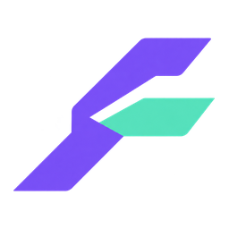
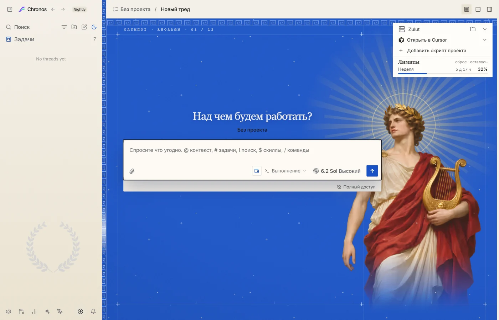
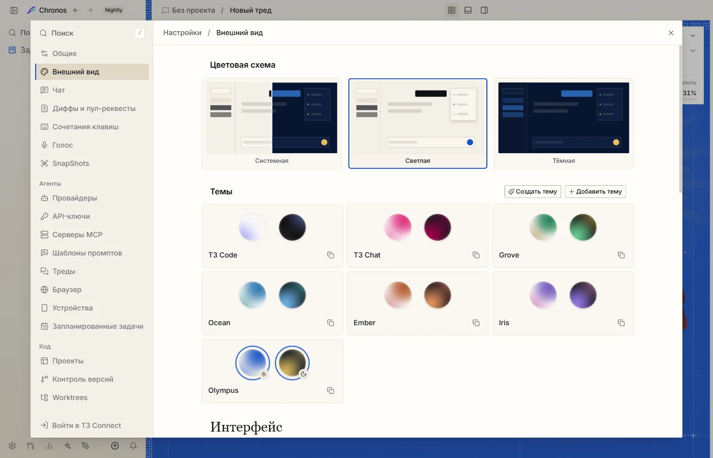

<h1 align="center">Chronos</h1>

A desktop app for coding agents with a Russian interface and tools from Olympus.

<strong>English</strong> · <a href="README.md">Русский</a>

  
  
  
  
  

<a href="#download">Download</a> · <a href="#differences-from-t3-code">Differences from T3 Code</a> · <a href="#features">Features</a> · <a href="#updates-and-upstream-sync">Updates</a> · <a href="#faq">FAQ</a>

> [!IMPORTANT]
> Chronos is an unofficial, independent fork of the T3 Code source. It is not affiliated with, endorsed by, or supported by T3 Tools, Inc. 
> Chronos installs alongside T3 Code and keeps its data separate. Please use [Chronos Issues](https://github.com/Zulut30/Chronos/issues) for questions, bugs, and ideas.

## Download

| Platform | Installer | Installation |
| --- | --- | --- |
| Windows x64 | [Chronos-Setup-x64.exe](https://github.com/Zulut30/Chronos/releases/latest/download/Chronos-Setup-x64.exe) | Run the NSIS installer. |
| macOS · Apple Silicon | [Chronos-mac-arm64.dmg](https://github.com/Zulut30/Chronos/releases/latest/download/Chronos-mac-arm64.dmg) | Open the DMG and drag Chronos to Applications. |
| macOS · Intel | [Chronos-mac-x64.dmg](https://github.com/Zulut30/Chronos/releases/latest/download/Chronos-mac-x64.dmg) | Open the DMG and drag Chronos to Applications. |

These links point to the latest release. Linux builds are unavailable.

To verify a download, compare the command output with the entry for your file in [SHA256SUMS](https://github.com/Zulut30/Chronos/releases/latest/download/SHA256SUMS).

- Windows — `certutil -hashfile Chronos-Setup-x64.exe SHA256`
- macOS — `shasum -a 256 Chronos-mac-arm64.dmg` (on Intel, use `Chronos-mac-x64.dmg`)

Opening an unsigned build for the first time

**Windows.** In SmartScreen, select **More info** → **Run anyway**.

**macOS.** In Applications, right-click Chronos and choose **Open**. For a copy in the standard location, you can also run `xattr -dr com.apple.quarantine /Applications/Chronos.app`.

Release files ending in `.blockmap`, `.zip` and `.yml` are used by the automatic updater.

## Differences from T3 Code

The comparison uses T3 Code nightly `0.1.10-nightly.20261116.4774`, the base for the Olympus port.

| Area | T3 Code | Chronos |
| --- | --- | --- |
| Origin | Upstream project | A port of Olympus, the author’s personal build |
| App profile | T3 Code profile | Separate Chronos profile |
| Server directory | `T3CODE_HOME` | `CHRONOS_HOME` |
| App links | `t3code://` | `chronos://` |
| Updates | T3 Code channel | Zulut30/Chronos releases |
| Interface | T3 Code interface | Olympus Russian translation, including dynamic text |
| Appearance | Theme settings | Olympus theme and a day/night switch in the sidebar |
| Chats | Project threads | Two chats side by side and a response mode saved per thread |
| Statistics | Provider statistics | OpenRouter spending included on the statistics page |

## Features

### Interface and theme

The build applies the Olympus dictionary and translation rules to produce a fully Russian interface. Dynamic strings are translated at runtime. The Greek-inspired Olympus theme has day and night variants, with a switch in the sidebar. Theme CSS can contain up to 4 MB to accommodate embedded images.

Agents can use color and text formatting in chat. Formatting is preserved when you copy a message.

### Agents, models, and token usage

The Electron app works with Claude Code, Codex, Cursor, OpenCode, Antigravity, OpenRouter, and other providers through your own subscriptions or API keys.

- Choose from five response modes, including planning. Chronos remembers the mode for each thread.
- The model picker shows the selected account’s email and plan. OpenRouter has its own provider entry, logo, and models. Its spending appears on the statistics page.
- Track generation speed in tokens per second, token usage, and provider budgets and limits. Chronos sends budget and limit notifications. The details card shows limits and related threads. Background tasks have their own details view.
- In the message composer, use `@` for context, `#` for tasks, `!` for search, `$` for skills, `/` for commands. A selected reference appears as a chip in the message.

### Tasks, studio, and chat panels

Each project has a task board with Kanban and list views, due dates, filters, and links to chats. The studio includes Excalidraw boards and WordPress Playground. You can send a board to a chat as an image. Open any chat in the right panel to work with two chats side by side.

### Files and environments

Upload files and folders from any environment and give machines aliases. Language icons are color-coded in the file tree and in diff headers.

### Settings and local services

Settings includes pages for API keys, MCP servers, and prompt templates, along with a skill manager.

> [!NOTE]
> The task board, studio, skill manager, file uploads, API keys page, and MCP manager rely on separate local Olympus Node.js services on `127.0.0.1`. The installer does not yet include them. Without these services, those sections are empty or unavailable. Bundling the services is the next step. Other features run independently of them.

## Updates and upstream sync

CI tracks T3 Code nightly builds daily and prepares updates on `upstream-sync/*` branches. Installed copies update through `electron-updater`, using the `nightly.yml` and `nightly-mac.yml` feeds from [Chronos Releases](https://github.com/Zulut30/Chronos/releases).

Chronos uses its own app ID `io.github.zulut30.chronos`.

| Data | Location |
| --- | --- |
| Windows profile | `%APPDATA%\Chronos` |
| macOS profile | `~/Library/Application Support/Chronos` |
| Server data | `~/.chronos` (override with `CHRONOS_HOME`) |
| CLI command | `~/.chronos/bin/t3` |

## FAQ

Can I install Chronos alongside T3 Code?

Yes. The apps use separate profiles, data directories, and update channels. Chronos leaves T3 Code data untouched.

Why does my system warn about an unknown publisher?

Chronos builds are unsigned. See [Download](#download) for the first-launch steps on Windows and macOS.

Why can’t I sign in with GitHub or Google?

You can sign in to a T3 Connect account with a code sent by email. Apple, GitHub, Google, and Microsoft sign-in buttons are unavailable in Chronos because the T3 sign-in service does not accept the `chronos://` callback.

Why is the task board or studio empty?

Both sections get their data from local Olympus services, which are currently installed separately. [See all features that require these services](#settings-and-local-services).

How do I report a bug?

Open an [issue in the Chronos repository](https://github.com/Zulut30/Chronos/issues) with your OS, Chronos version, and steps to reproduce the problem.

## For developers

Fork layout, local builds, and CI

Olympus modules are copied byte for byte. Where the port requires changes to T3 Code source files, those edits are kept minimal. See the [fork guide](chronos/README.md) and [parity reports](chronos/parity/).

Local builds follow upstream requirements for Node.js, pnpm, and Vite+. See the [T3 Code docs](https://github.com/pingdotgg/t3code/tree/main/docs) and [package.json](package.json).

CI [builds the bundle and installers](.github/workflows/chronos-desktop.yml), [runs checks](.github/workflows/chronos-checks.yml), and [verifies translation parity](.github/workflows/chronos-parity.yml).

## License and trademarks

Thank you to the T3 Code team for making the source available. The code is licensed under the [MIT License](LICENSE). T3 Code, T3 Connect, T3 Tools, and the T3 logos and icons are trademarks of T3 Tools, Inc. The code license grants no rights to those marks. See [NOTICE.md](NOTICE.md).

Chronos is an unofficial, independent project. It is not affiliated with, endorsed by, or supported by T3 Tools, Inc. Direct questions and bug reports to [Chronos Issues](https://github.com/Zulut30/Chronos/issues).
