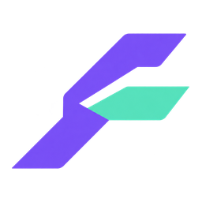
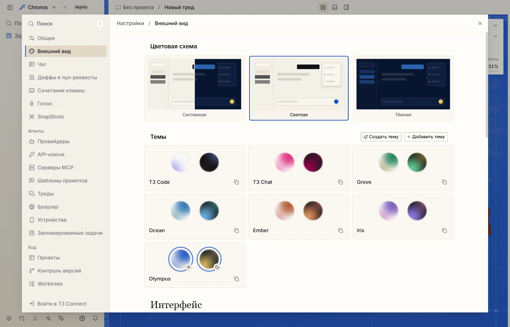

<h1 align="center">Chronos</h1>

Настольное приложение для ИИ-агентов программирования с русским интерфейсом и инструментами Olympus.

<strong>Русский</strong> · <a href="README.en.md">English</a>

  
  
  
  
  

<a href="#скачать">Скачать</a> · <a href="#отличия-от-t3-code">Отличия от T3 Code</a> · <a href="#возможности">Возможности</a> · <a href="#обновления-и-синхронизация-с-t3-code">Обновления</a> · <a href="#faq">FAQ</a>

> [!IMPORTANT]
> Chronos — неофициальный независимый форк на базе исходного кода T3 Code. Проект не связан с T3 Tools, Inc. и не получает одобрения или поддержки компании. 
> Chronos ставится рядом с T3 Code и хранит данные отдельно. Вопросы, ошибки и идеи — в [Issues Chronos](https://github.com/Zulut30/Chronos/issues).

## Скачать

| Платформа | Установщик | Установка |
| --- | --- | --- |
| Windows x64 | [Chronos-Setup-x64.exe](https://github.com/Zulut30/Chronos/releases/latest/download/Chronos-Setup-x64.exe) | Запустите установщик NSIS. |
| macOS · Apple Silicon | [Chronos-mac-arm64.dmg](https://github.com/Zulut30/Chronos/releases/latest/download/Chronos-mac-arm64.dmg) | Откройте DMG и перенесите Chronos в «Программы». |
| macOS · Intel | [Chronos-mac-x64.dmg](https://github.com/Zulut30/Chronos/releases/latest/download/Chronos-mac-x64.dmg) | Откройте DMG и перенесите Chronos в «Программы». |

Ссылки ведут на последний релиз. Сборки для Linux не выпускаются.

Для проверки загрузки сравните результат команды со строкой вашего файла в [SHA256SUMS](https://github.com/Zulut30/Chronos/releases/latest/download/SHA256SUMS).

- Windows — `certutil -hashfile Chronos-Setup-x64.exe SHA256`
- macOS — `shasum -a 256 Chronos-mac-arm64.dmg` (для Intel укажите `Chronos-mac-x64.dmg`)

Первый запуск неподписанной сборки

**Windows.** В окне SmartScreen нажмите «Подробнее» → «Выполнить в любом случае».

**macOS.** В «Программах» нажмите на Chronos правой кнопкой мыши и выберите «Открыть». Для копии в стандартной папке можно также выполнить `xattr -dr com.apple.quarantine /Applications/Chronos.app`.

Файлы релиза `.blockmap`, `.zip` и `.yml` нужны для автообновления.

## Отличия от T3 Code

Сравнение с T3 Code nightly `0.1.10-nightly.20261116.4774`, на которой основан перенос Olympus.

| Область | T3 Code | Chronos |
| --- | --- | --- |
| Происхождение | Исходный проект | Перенос Olympus, личной сборки автора |
| Профиль приложения | Профиль T3 Code | Отдельный профиль Chronos |
| Каталог сервера | `T3CODE_HOME` | `CHRONOS_HOME` |
| Ссылки приложения | `t3code://` | `chronos://` |
| Обновления | Канал T3 Code | Релизы Zulut30/Chronos |
| Интерфейс | Интерфейс T3 Code | Русский перевод Olympus, включая динамический текст |
| Оформление | Настройки темы | Тема Olympus и переключатель дня и ночи в сайдбаре |
| Чаты | Треды проекта | Два чата рядом, режим ответа запоминается для каждого треда |
| Статистика | Статистика провайдеров | Учёт расходов OpenRouter на странице статистики |

## Возможности

### Интерфейс и тема

Словарь и правила Olympus переводят интерфейс на русский при сборке. Динамические строки переводятся во время работы. У темы Olympus с греческими мотивами два варианта оформления. Кнопка «День / ночь» в сайдбаре переключает их. Лимит CSS темы увеличен до 4 МБ для встроенных изображений.

Агенты могут выделять текст в чате цветом и начертанием. При копировании форматирование сохраняется.

### Агенты, модели и расход токенов

В приложении на Electron можно работать с Claude Code, Codex, Cursor, OpenCode, Antigravity, OpenRouter и другими провайдерами через свои подписки или API-ключи.

- Выберите один из пяти режимов ответа, включая планирование. Chronos запомнит выбор для этого треда.
- В меню модели видны почта и тариф выбранного аккаунта. У OpenRouter есть собственная запись с логотипом и списком моделей, а расходы попадают в статистику.
- Следите за скоростью генерации в токенах в секунду, статистикой токенов, бюджетами и лимитами провайдеров. Chronos присылает уведомления о бюджетах и лимитах. В карточке деталей видны лимиты и связанные треды, у фоновых задач можно открыть подробности.
- В поле сообщения используйте `@` для контекста, `#` для задач, `!` для поиска, `$` для скиллов, `/` для команд. Выбранная ссылка появляется прямо в сообщении.

### Задачи, студия и панели чатов

У каждого проекта своя доска задач. Переключайтесь между канбаном и списком, задавайте сроки, фильтруйте задачи и привязывайте их к чатам. В студии доступны доски Excalidraw и WordPress Playground. Доску можно отправить в чат картинкой. Чтобы работать с двумя чатами рядом, откройте любой чат в правой панели.

### Файлы и окружения

Загружайте файлы и папки из любого окружения. Машинам можно назначить псевдонимы. Цветные иконки языков видны в дереве файлов и в заголовках диффов.

### Настройки и локальные сервисы

В настройках есть страницы «API-ключи», «Серверы MCP» и «Шаблоны промптов», а также менеджер скиллов.

> [!NOTE]
> Доска задач, студия, менеджер скиллов, загрузка файлов, «API-ключи» и менеджер MCP используют отдельные локальные сервисы Olympus на Node.js (`127.0.0.1`). Пока установщик их не включает, без этих сервисов перечисленные разделы пусты или недоступны. Следующий шаг — поставлять сервисы вместе с Chronos. Остальные функции не требуют этих сервисов.

## Обновления и синхронизация с T3 Code

CI ежедневно сверяется с nightly T3 Code и готовит обновления в ветках `upstream-sync/*`. Установленное приложение получает автообновления через `electron-updater` из [релизов Chronos](https://github.com/Zulut30/Chronos/releases) по лентам `nightly.yml` и `nightly-mac.yml`.

У Chronos свой идентификатор приложения `io.github.zulut30.chronos`.

| Данные | Расположение |
| --- | --- |
| Профиль Windows | `%APPDATA%\Chronos` |
| Профиль macOS | `~/Library/Application Support/Chronos` |
| Данные сервера | `~/.chronos` (можно изменить через `CHRONOS_HOME`) |
| Команда CLI | `~/.chronos/bin/t3` |

## FAQ

Можно ли установить Chronos рядом с T3 Code?

Да. У приложений разные профили, каталоги данных и каналы обновлений. Chronos не изменяет данные T3 Code.

Почему система предупреждает о неизвестном издателе?

Сборки Chronos выпускаются без подписи издателя. Инструкции для SmartScreen и macOS приведены в разделе [«Скачать»](#скачать).

Почему не работает вход через GitHub или Google?

Поддерживается вход в аккаунт T3 Connect по коду из письма. Кнопки Apple, GitHub, Google и Microsoft в Chronos недоступны, поскольку сервис входа T3 не принимает адрес обратного вызова `chronos://`.

Почему доска задач или студия пуста?

Оба раздела получают данные от локальных сервисов Olympus, которые пока устанавливаются отдельно. [Полный список зависимых разделов](#настройки-и-локальные-сервисы).

Как сообщить об ошибке?

Откройте [Issue в репозитории Chronos](https://github.com/Zulut30/Chronos/issues) и укажите вашу ОС, версию Chronos и шаги для воспроизведения.

## Для разработчиков

Устройство форка, локальная сборка и CI

Модули Olympus переносятся байт в байт. Когда для переноса нужно изменить исходники T3 Code, правки минимальны. См. [устройство форка](chronos/README.md) и [отчёты о паритете](chronos/parity/).

Требования к Node.js, pnpm и Vite+ те же, что у исходного проекта. См. [документацию T3 Code](https://github.com/pingdotgg/t3code/tree/main/docs) и [package.json](package.json).

CI [собирает бандл и установщики](.github/workflows/chronos-desktop.yml), [запускает проверки](.github/workflows/chronos-checks.yml) и [сверяет перевод](.github/workflows/chronos-parity.yml).

## Лицензия и товарные знаки

Спасибо команде T3 Code за открытый исходный код. Код распространяется по [лицензии MIT](LICENSE). «T3 Code», «T3 Connect», «T3 Tools», а также логотипы и иконки T3 — товарные знаки T3 Tools, Inc. Лицензия на код не предоставляет прав на эти знаки. См. [NOTICE.md](NOTICE.md).

Chronos — неофициальный независимый проект. Он не связан с T3 Tools, Inc., не одобрен и не поддерживается компанией. Вопросы и ошибки направляйте в [Issues Chronos](https://github.com/Zulut30/Chronos/issues).
